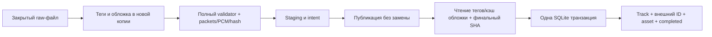

# Координатор публикации и атомарного импорта — пакет 35

Пакет 34 подтверждён пользователем; скриншот показывает успешную квалификацию
FFmpeg 7.1.5. Пакет 35 связывает ранее отдельные компоненты. Схема остаётся 13,
hosted dependencies и helper binaries не меняются. Сеть/вход/кнопка обновления
Яндекса, расписание и автоматический startup runner ещё не подключены.

## Граница процесса

`DesktopDownloadCoordinator.processDownloadedFile` получает актуальное running/
download задание, уже полностью скачанный закрытый local FileAudioSource,
политику кодирования/теги и необязательную обложку. Raw-файлом эксклюзивно владеет
вызывающий transport; координатор его не удаляет и не пишет в него. Ожидаемый
title обязателен: итоговое имя ресурса не должно становиться названием трека.
Транспорт, claimNext, выбор/повторы заданий остаются обязанностью будущего runner.
Если transport продлевал lease, передавать нужно последний снимок после
дренирования его heartbeat. Координатор подтверждает его собственным renew.

Один координатор исполняет одно задание, затем может принять следующее.
Publisher держит OS resource lock на протяжении подготовки/публикации/импорта.
Preparer выдаёт отдельный проверенный файл; publisher получает его поток с
точным размером и повторно проверяет staging. Сеть/hash/decode/tag reading и
artwork cache остаются вне SQLite writer reservation.

После публикации итоговый файл получает read seal. Отдельный строгий
`EmbeddedAudioMetadataReaderService` читает теги в isolate и не использует
filename fallback: при ошибке reader нельзя импортировать `cmp-<hash>` как
название или вывести исполнителя из служебного имени. Обычный scanner reader
не меняет прежнее поведение. Кэш обложек общий с библиотекой, по хэшу; после
чтения/кэширования выполняется ещё один полный SHA-256/size check. Проверка
формата/качества/decode уже доказана идентичностью байтов с проверенным файлом.

Путь в Track строится от сохранённого адреса выбранной папки, как при сканировании,
а не от её возможного canonical alias. Импорт повторно сверяет этот адрес в БД.
Физический publisher по-прежнему использует canonical root. Это предотвращает
создание второго Track для своего результата из-за обычного сканирования через
тот же сохранённый адрес. Разные реальные экземпляры/внешние ID не сливаются по
названию или metadata signature.

## Lease и короткие эффекты

`DownloadLeaseOwner`: lease 60 секунд, heartbeat раз в 20 секунд. Одновременно
ожидается не больше одного heartbeat; DB-команды и короткие fences проходят
через последовательную очередь. Hash/FFmpeg/metadata/потоки очередь не держат.
Владение относится только к одному job/key/account/revision-session/attemptToken.
Потеря владения или ошибка renew отменяет медиаоперацию; чужой token не принимается.

Publisher использует узкий `PublicationJobAccess`. Только приватно владеющий
попыткой owner может заменить устаревшую heartbeat-ревизию на последнюю, под
своей очередью и в том же этапе/попытке. Обычный DownloadJobRepository по-прежнему
требует полный точный CAS snapshot. Иначе heartbeat во время длинного хэширования
делал бы собственный успешный файл устаревшим перед переносом.

SQLite writer reservation всё равно проверяет текущую сессию/папку/lease после
ожидания writer и сразу перед коротким эффектом. Heartbeat не продлевает уже
утраченную lease и не обещает успех при произвольной остановке процесса/ОС.
По завершении атомарного импорта owner принимает completed snapshot до освобождения
очереди, поэтому уже ожидающий timer не может продлить завершённое задание.

## Атомарный импорт

`DownloadedTrackImport` — проверяемое согласование job/key, публикации, source,
готового Track и фактического качества/hash/size/duration. ID публикации — 64 hex,
готовое имя вычисляется из resource key и ID. Нельзя передать готовый локальный
Track ID, другой folder, manual/custom metadata или content URI в desktop import.
Политика не является аутентификацией недоверенного кода: caller обязан действительно
проверить файл и удерживать lock/seal до commit.

`DriftDownloadImportRepository.commit` сначала резервирует SQLite writer, затем
в той же транзакции:

1. Проверяет актуальный snapshot, сессию, папку, этап importing и адрес источника.
2. Импортирует Track через существующий batch scan contract: ID/addedAt,
   очищенные вручную поля, custom cover и пользовательская статистика сохраняются.
3. Добавляет точный providerResponse ref; более сильный manual ref не понижается.
4. Регистрирует asset; существующая та же публикация получает свежее подтверждение
   при восстановлении, другая публикация/владелец источника не заменяются.
5. Завершает эту же попытку и задание с текущим временем и evidence этой попытки.

Если final complete отвергнут (например, lease истекла во время транзакции),
исключение проходит через все savepoints и откатывает Track/ref/asset/attempt/job.
Возврат null после частичных записей был бы ошибкой; отдельный внутренний сигнал
rollback преобразуется в null только снаружи транзакции. Сбой любого INSERT/
UPDATE также ничего не оставляет. Cover cache не входит в SQLite транзакцию:
неиспользованный hash-addressed файл после rollback может остаться до будущего GC.

Повтор потерянного acknowledgement допускается только для той же завершённой
публикации/байтов/попытки и текущей сессии/папки. Он возвращает реальные сохранённые
Track/asset/job и не пишет их заново, не сбрасывает ручные изменения и не добавляет
попытку/историю. Другой ID/байты, новый сеанс или изменённый текущий результат
не превращаются в успех. Два отдельных SQLite подключения импортируют один раз;
второе получает replay после reservation.

## Отмена, сбой и восстановление

До возможной публикации cancel дренирует работу и отменяет попытку. После принятого
переноса поздняя пользовательская отмена дренирует импорт; потеря lease/сессии
всё равно запрещает commit. Файлы пользователя/опубликованная музыка не удаляются.
Busy на входе сохраняет ту же попытку: caller может повторить её без нового claim.
Busy уже после возможного переноса требует reconciliation.

При неопределённом файловом эффекте или ошибке импорта `interrupt` завершает
попытку и переводит задание в needsReconciliation, сохраняя checkpoint и оставшийся
бюджет. При исчерпании — failed до явного ручного retry. Если запись этого состояния
в БД тоже не удалась, результат не объявляется completed; фактический snapshot
остаётся executing и подлежит существующему recoverExpired.

`recover` принимает новую reconciling попытку. Читает ограниченный журнал и
проверяет реально существующие итоговые пути; только один опубликованный кандидат
можно сверить полным хэшем и импортировать с новым временем evidence. Нет файла —
возврат requiresDownload с running/download snapshot; один лишь intent/partial
не считается готовым аудио. Новая обработка может оставить прежний неподтверждённый
journal entry до retention. Несколько существующих кандидатов, повреждённые байты,
небезопасный путь/журнал не угадываются и не удаляются.

close закрывает приём, отменяет текущую работу и дренирует её, включая забытый
caller Future. Временный prepared результат, publisher, hash worker и heartbeat
закрываются до backend; SQLite закрывается владельцем приложения последней.
Поздняя ошибка освобождения seal после успешного commit отмечает cleanupFailed,
не превращая завершённую транзакцию в неуспешную.

## Проверка и оставшиеся ограничения

65 новых сценариев: 23 atomic import, 10 lease/interrupt, 22 coordinator,
6 strict tag reader и 4 настоящих FFmpeg pipeline checks. Проверяются откат на
каждом write, два SQLite connections, ручные поля/обложка/статистика, stale
lease/account/folder, heartbeat во время seal, busy/retry, pre/late cancel,
drained close, отсутствующие/изменённые файлы и неоднозначный журнал.
Native checks используют только CC0 tones/covers из repository fixtures,
реальные FFmpeg MP3/M4A/FLAC и обычный reader/cache/OS locks. Четвёртый сценарий
закрывает координатор и persistent SQLite, открывает БД заново и восстанавливает
импорт без helper/process/download. Музыка, профиль и аккаунт пользователя
в этих тестах не используются.

Полный локальный набор: **1366 passed**, concurrency 4, 48 секунд; analyze
без замечаний, format 231 файл. Windows CI строит pinned helper до полного набора,
передаёт `CMP_TEST_MEDIA_HELPER` и исполняет native coordinator checks, затем
архивирует test native_assets.json перед release. На macOS эти четыре проверки
явно пропускаются, остальные общие tests/build сохраняются; физический Mac
pipeline здесь не объявляется проверенным.

До публичного runner необходимы retention/квоты/очистка журнала (включая
неподтверждённые staging), затем adapter/credentials/likes+selected playlists/UI.
Существующие лимиты publisher 10 000 entries / 256 entries одного ключа действуют;
накопленные несколько публикаций одного задания требуют явного решения, не
автоматического удаления. Windows/Mac file locks не являются OS sandbox от
посторонней замены дерева; power-loss/directory-fsync гарантии не добавляются.
Android требует native SAF preparation/validation/publication adapter; desktop
File API не используется для телефонных content URI. Автоматический retry,
расписание, shutdown hook окна ОС и cleanup/retention ещё не подключены к UI.
